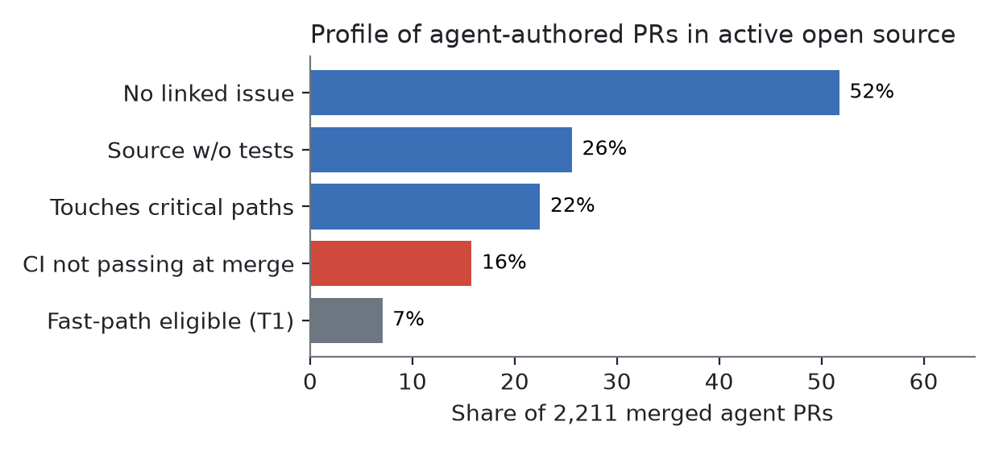
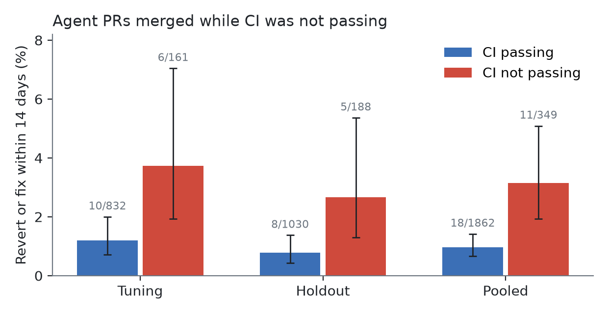

## Abstract

Coding agents now open a large share of pull requests, and platforms have started letting AI approve and merge them, yet little outcome data is public. We study 2,211 merged pull requests authored by four coding agents (GitHub Copilot coding agent, Devin, Cursor, Jules) in 571 active open-source repositories (≥50 stars, ≥3 human contributors, July–October 2026). Using a pre-registered protocol, we assign each PR a deterministic, metadata-only risk tier and label post-merge trouble as an explicit revert or an explicitly-referenced fix within 14 days. Trouble is rare: 1.3% of agent PRs (29 events; label precision 62–76% by manual audit of every event). The pre-registered test (high-risk vs. fast-path tier) is **inconclusive**: only 7% of agent PRs qualified for the fast path, and a power analysis shows 23,000–46,000 PRs would be needed, more than current public agent activity supplies. One signal stands out, with caveats: agent PRs **merged while CI was failing, pending or absent** (16% of the sample) were followed by a revert or fix **3.3× as often** as PRs merged with passing CI (3.2% vs 1.0%; Fisher p = 0.003, Holm-adjusted p = 0.034; repository-bootstrap 90% CI 1.5–6.2), in the same direction in both repository splits. Part of this effect is circular: when follow-ups that only repair the build (tests, lint, CI) are excluded, the ratio drops to 2.3× (p = 0.08, CI 0.8–4.9), and reverts alone show 5.3× on only 6 events (p = 0.054). Merging on red reliably creates follow-up work. Whether it causes downstream defects is suggested but not established. The finding also depends on a label correction made after inspecting the tuning set: under the original pre-registered label definition the effect was 1.5× and not significant (Appendix B). Half of agent PRs carry no linked issue, and a quarter change source code without touching tests. We release the pipeline, pre-registration, audit and PR-level dataset.

## Executive summary

**The question.** Coding agents now open a large share of pull requests, and AI tools have started approving and merging them. Which agent PRs actually cause trouble after they are merged? Nobody publishes this data.

**What we did.** We looked at 2,211 merged PRs written by four coding agents (GitHub Copilot, Devin, Cursor, Jules) in 571 active open-source projects. For each PR we checked whether it was reverted, or followed by a fix that explicitly referred to it, within two weeks. We wrote down our rules and hypotheses before looking at any outcome (one later correction to how outcomes are labelled is disclosed in Appendix B), and we read every flagged case by hand.

**What we found.**

| | |
|---|---|
| **Agent PRs often arrive without evidence** | 52% have no linked issue, 26% change code without touching tests, and **16% were merged while CI was red or missing**. Only 7% met a reasonable bar for a fast-track review. |
| **Post-merge trouble is rare** | About **1 in 75** agent PRs (1.3%) was reverted or needed a referenced fix within two weeks. None of the 156 fast-track-eligible PRs did. |
| **Merging on red creates follow-up work** | PRs merged without passing CI were followed by **about 3× as much follow-up work** (3.2% vs 1.0%). Part of that work is repairing the broken build itself. Whether merging on red also causes more real defects is suggested (2.3×) but not statistically established. |
| **Our main hypothesis could not be tested yet** | We set out to test whether "high-risk" PRs fail more often than "fast-track" ones. Public data is too small to answer this: it would take 10–20× more agent PRs than exist in active open-source projects today. |

**What engineering leaders can do now.**

1. **Make passing CI a hard requirement for merging agent PRs.** It is free, already built into GitHub branch protection, and was skipped for one in six agent PRs in our sample.
2. **Make agents bring evidence:** a linked issue, tests and green CI. Most agent PRs today cannot qualify for safe auto-approval because this evidence is missing.
3. **Measure your own outcomes before trusting AI approval.** Vendors do not publish how often AI-approved changes are later reverted. Our open-source pipeline can be pointed at your own repositories.

**Limits.** This is an exploratory, not peer-reviewed study of public open-source projects, which differ from private enterprise codebases. Outcome labels are approximate: about two thirds to three quarters of flagged cases were confirmed by hand. Per-agent numbers are descriptive and are not a ranking of vendors.

## 1. Introduction

Coding agents moved from autocomplete to authorship in 2025–2026. GitHub reports that agents initiated more than 40% of pull requests on the platform by September 2026, up from 17% in March of the same year [Octoverse 2026]. Downstream processes — review, CI, release — now scale with PR volume rather than headcount, and several telemetry studies report that review time and post-merge incidents rose alongside AI adoption [Faros 2025, 2026; DORA 2025].

Platforms have responded by letting AI approve changes. Copilot code review gained the ability to approve pull requests (general availability on 2026-10-28) with path-level restrictions [GitHub changelog]; Cursor routes PRs by risk and auto-approves those below a configurable threshold [Cursor docs]; CodeRabbit merges "low-risk" changes by rule [CodeRabbit]. Large engineering organisations report building the same pattern in-house [Vercel; Meta RADAR]. What is largely missing from public view is **outcome data**: which properties of an agent-authored change predict that it will later be reverted or need a fix?

This report asks a narrow, measurable question:

> Among merged pull requests authored by coding agents in open-source repositories, do simple, explainable, metadata-only risk signals predict post-merge trouble (revert or explicitly-referenced fix within 14 days)?

We deliberately use signals that can be computed **without reading code content** — file paths, change size, ownership boundaries, CI state, presence of tests and linked tickets — because these are cheap, deterministic, auditable, and privacy-preserving. The study was **pre-registered**: metrics, thresholds and decision rules were committed to the project's repository before any outcome data was fetched; the full history is published with this report.

Contributions:

1. A pre-registered, reproducible pipeline for measuring post-merge outcomes of agent-authored PRs from public GitHub data.
2. An exploratory analysis of which metadata signals are associated with reverts and fixes across four coding agents.
3. An open dataset of PR identifiers, features, tiers and outcome labels (no code or PR text).

## 2. Background and related work

**Productivity and quality of AI-assisted development.** Evidence is mixed. Telemetry from Faros AI across >10,000 developers associates high AI adoption with more merged PRs but also longer review times and larger PRs, without a clear company-level delivery improvement [Faros 2025]; its 2026 follow-up reports large increases in review time and incidents per PR [Faros 2026]. DORA 2025 concludes that AI amplifies existing engineering conditions rather than automatically improving delivery [DORA 2025]. METR's randomised study found experienced developers were slower with early-2025 tools despite believing otherwise, with a 2026 update reporting a small, uncertain speed-up [METR 2025, 2026]. Vendor studies report more issues in AI-authored PRs [CodeRabbit 2025] and frequent security weaknesses in LLM-generated code [Veracode 2025]. These are primarily productivity or code-level quality measures; few report **post-merge outcomes by change type for agent-authored PRs**.

**Risk-based review.** The idea that review effort should be proportional to change risk predates coding agents (e.g. ownership-aware review routing, CODEOWNERS). Practitioner reports describe risk-based review increasing merge throughput [Pragmatic Engineer 2026], and industrial systems combine static heuristics with learned risk scores [Meta RADAR, arXiv 2605.30208]. Commercial tools now ship AI approval and risk routing (Section 1), but we found no published false-approval or post-merge revert rates for these systems.

**Measuring defect-inducing changes.** Post-merge outcomes are usually approximated with SZZ-style heuristics that link fixing commits to the changes that introduced the defect. These heuristics are noisy; reported precision varies widely [Rosa et al. 2021; SANER 2025]. We therefore use a deliberately conservative outcome definition (explicit reverts and fixes that reference the PR) and report it as a lower bound rather than a defect rate.

## 3. Data

**Sources.** Merged pull requests authored by four coding-agent GitHub Apps — `copilot-swe-agent`, `devin-ai-integration`, `cursor`, `google-labs-jules` — merged between 2026-07-01 and 2026-10-15, so that every PR has a complete 14-day outcome window before data collection. GitHub search was sliced into weekly windows to stay within its 1,000-results-per-query cap.

**Repository filters (pre-registered).** Not a fork; not archived; ≥ 50 stars; ≥ 3 distinct human contributors; and CI results present on ≥ 50% of sampled PRs. These filters remove personal and toy repositories, which dominate raw agent PR volume. At most 30 PRs per repository were sampled (deterministic hash order) so that no single project dominates.

**Funnel.** 61,629 candidate PRs in 12,331 repositories → 630 repositories passing the star, fork and contributor filters → 2,361 PRs collected (≤ 30 per repository) → **2,211 PRs in 571 repositories** after the CI-coverage filter and one PR excluded for an incomplete history window. By agent: Copilot coding agent 729 PRs (395 repositories), Cursor 801 (103), Devin 572 (68), Jules 109 (10). Raw agent PR volume is dominated by personal repositories; ~95% of candidate repositories did not pass the activity filters.

**Features (metadata only).** For each PR: author account type and identity; file paths with additions, deletions and change type (GitHub GraphQL, which exposes no patch content); total changed files; head-commit CI rollup state; commit messages (for agent trailers); title, body and branch name (for ticket references only); and `.github/CODEOWNERS` read at the PR's base commit.

**Split.** Repositories were assigned to a tuning or holdout set by `sha256(owner/name) mod 2` before outcomes were fetched.

## 4. Method

**Risk tiers.** A deterministic rules engine (released with this report) assigns each PR to one of three tiers:

- **T3 (owner/senior review)** if any of: touches review-control files (CODEOWNERS, router config); file list truncated or > 3,000 files; touches critical paths (migrations, infrastructure, CI workflows, auth/security, dependency manifests); ≥ 800 counted changed lines (lockfiles and generated files excluded); ≥ 10 deleted files; spans ≥ 3 CODEOWNERS groups.
- **T1 (fast path)** if small (≤ 150 counted lines, ≤ 10 files), CI passing, tests changed alongside source (or docs-only), and — for agent PRs — a linked issue or ticket.
- **T2** otherwise. Ambiguity resolves upward (fail-closed): uncertain inputs never yield T1.

Tiers depend on the change's blast radius and evidence, not on which agent wrote it.

**Outcomes (14 days after merge, default-branch commits).**

- *Revert*: a commit whose subject starts with "Revert" and that names the PR (merge SHA, PR number, or `Revert "<PR title>"`).
- *Fix follow-up*: a non-revert commit with a fix keyword (`fix`, `bug`, `hotfix`, `regression`, `broken`) in its **subject** that explicitly references the PR number or merge SHA.
- Excluded: release, changelog, version-bump and branch-merge commits, commits referencing more than 3 PR numbers, and the PR's own commit landed under a different SHA (Appendix B, D1–D2).
- *Event* = revert OR fix follow-up.

**Pre-registered decision rule (holdout).** Ratio R = event rate(T3) / event rate(T1) with a 90% bootstrap CI over repositories (2,000 resamples). Pass if R ≥ 2 and CI lower bound > 1; fail if R < 2; inconclusive if T1 or T3 has < 300 PRs or there are < 30 events.

**Exploratory analysis.** For each binary feature, event rates with vs. without the feature, two-sided Fisher exact test, Holm–Bonferroni correction across features. Findings are described as significant only when the Holm-adjusted p < 0.05; all others are reported as trends.

## 5. Results

### 5.1 What agent PRs look like

| | All | Copilot | Cursor | Devin | Jules |
|---|---|---|---|---|---|
| PRs (repositories) | 2,211 (571) | 729 (395) | 801 (103) | 572 (68) | 109 (10) |
| No linked issue/ticket | 52% | 33% | 64% | 51% | 91% |
| Source changed without test changes | 26% | 29% | 21% | 22% | 55% |
| Merged with CI not passing (failing/pending/absent) | 16% | 21% | 14% | 11% | 13% |
| Touches critical paths | 22% | 32% | 17% | 22% | 5% |
| Tier T1 / T2 / T3 | 7 / 66 / 27% | 13 / 53 / 34% | 4 / 77 / 19% | 5 / 62 / 33% | 1 / 91 / 8% |
| Revert or fix within 14 days | 1.3% | 1.2% | 2.0% | 0.7% | 0.0% |

Per-agent columns are descriptive. Agents differ in the repositories and tasks they are used for, so these columns are **not** a quality ranking (Section 6).

The fast path is rarely available: only 7% of agent PRs met all T1 conditions. The most common blocker was a missing issue link (52%), then source changes without tests (26%) and CI not passing (16%).

### 5.2 Pre-registered test

| Split | PRs | T1 (events) | T2 (events) | T3 (events) | Verdict |
|---|---|---|---|---|---|
| Tuning | 993 | 67 (0) | 660 (10) | 266 (6) | inconclusive |
| Holdout | 1,218 | 89 (0) | 798 (11) | 331 (2) | inconclusive |
| Pooled | 2,211 | 156 (0) | 1,458 (21) | 597 (8) | — |

No T1 PR in either split was followed by a revert or fix (0/156; one-sided 95% upper bound ≈ 1.9%). T3 PRs had more reverts than T2 (3 of 6 reverts in the 27% of PRs that were T3), but overall event rates for T2 and T3 were similar (1.4% vs 1.3%). The pre-registered verdict is **inconclusive**: T1 and T3 fall short of the 300-PR minimum and there are fewer than 30 events per split.

**Power.** Detecting a 2× difference between T1 and T3 at 80% power (α = 0.05, two-sided) needs 1,500–3,100 PRs per tier for baseline event rates of 1.5%–0.75%. At the observed T1 share (7%) that is roughly **23,000–46,000 agent PRs** from active repositories, 10–20× this sample. The eligible pool (630 repositories) cannot supply it at current agent activity, so we did not extend the sample.

### 5.3 Exploratory signals

The feature list was fixed before outcomes were evaluated (Appendix B, D0). Fisher exact tests with Holm correction across 11 features, pooled sample:

| Feature | n with | Rate with | Rate without | Rate ratio | p | Holm p |
|---|---|---|---|---|---|---|
| **Merged with CI not passing** | 349 | **3.15%** | 0.97% | **3.26** | **0.003** | **0.034** |
| Authored by Cursor | 801 | 2.00% | 0.92% | 2.17 | 0.050 | 0.50 |
| No linked issue/ticket | 1,144 | 1.66% | 0.94% | 1.77 | 0.19 | 1.0 |
| Large change (≥ 800 lines) | 134 | 2.24% | 1.25% | 1.79 | 0.26 | 1.0 |
| Source changed without tests | 566 | 0.71% | 1.52% | 0.47 | 0.20 | 1.0 |
| Touches critical paths | 497 | 1.01% | 1.40% | 0.72 | 0.66 | 1.0 |

Only one signal survives correction: **merging while CI is not passing**. Note on measurement: CI state is the head commit's status rollup observed after merge. It includes non-required checks, so "merged while failing" slightly overstates what was measured: some failing checks may not have been blocking. Robustness checks:

- **Replication across splits:** tuning 3.7% vs 1.2% (p = 0.032); holdout 2.7% vs 0.8% (p = 0.037).
- **Repository clustering:** bootstrap over repositories gives a 90% CI for the rate ratio of 1.47–6.24.
- **Label noise:** restricting to events confirmed by manual audit gives 3.4× (2.0% vs 0.6%, p = 0.015, bootstrap CI 1.2–8.0); including probable events, 3.7× (p = 0.004).
- **Circularity (build repair):** 6 of the 29 events are follow-ups that repair tests, lint, e2e or CI rather than behaviour (e.g. *"fix(e2e): stabilize Appium …"*, *"fix: satisfy clippy …"*). PRs merged on red will naturally attract such commits. Excluding them, the ratio is **2.3× (7/349 vs 16/1,862; p = 0.077; bootstrap CI 0.82–4.91)**, no longer significant. Reverts alone: 3/349 vs 3/1,862 (5.3×, p = 0.054, CI 0.75–19.3).
- **Replication caveat:** the per-split p-values are nominal. On the holdout alone, the CI feature is one of 11 tests and does not survive Holm correction within that split.
- **Original label definition:** under the pre-registered (uncorrected) labels, the effect is 1.47× pooled (p = 0.12) and 1.77× on the holdout (p = 0.094). The original definition counted 102 events, most of them false alarms from release and changelog commits (Appendix B).

**Interpretation.** Merging agent PRs while CI is not passing is reliably followed by more follow-up work, a substantial part of which is repairing the build. Evidence that it also leads to more behavioural defects is directionally consistent but not statistically established in this sample.

Critical-path changes (migrations, workflows, infrastructure, auth, dependency manifests) were **not** followed by more fixes in this sample. The likely reasons are that such changes get closer human review before merge, and that their failures surface outside git history. Missing tests showed no association; the direction is even reversed, possibly because test-only and docs-adjacent changes dominate that group.

### 5.4 Label audit

We read every one of the 29 events. 18 are clear (e.g. a GitHub revert; *"kept firing after #7438 declared it fixed"*; *"still used … after #3986/#4005 fixed the same collision"*), 4 probable, 2 ambiguous (planned removal of a workaround; revert of a related change), and 5 false (the PR's own commit with a paraphrased subject, a docs credit commit, a merge commit, a different PR's revert, and a later PR that merely mentions the number). Precision is therefore 62–76%, comparable to SZZ-style approaches [Rosa et al. 2021]. Recall cannot be measured from git history alone, so all rates are **lower bounds** on post-merge trouble.

## 6. Threats to validity

- **Outcome measurement.** Reverts and explicitly-referenced fixes are a lower bound on trouble; silent fixes, direct pushes without references, and incidents not tracked in git are missed. Label noise is expected despite the conservative definition.
- **Selection.** Open-source repositories with ≥ 50 stars are not representative of private enterprise codebases. Agents may be deployed on easier tasks; maintainers may merge agent PRs selectively.
- **Confounding.** Larger or critical-path changes may be reverted more because they are more visible or because the projects that make them are more active, not only because they are riskier. Per-agent differences are confounded with repository mix and task type; we do not rank vendors.
- **Clustering.** PRs within a repository are not independent. We bootstrap by repository for the primary ratio and for the CI finding, but Fisher tests in the exploratory table treat PRs as independent.
- **CI finding is associational.** Merging while CI is not passing may mark repositories or maintainers with looser practices rather than cause later fixes. The repository bootstrap handles clustering, not repository-level confounding. A within-repository comparison needs more PRs per repository than this sample has.
- **Attribution.** Agent identity comes from the PR author account; human-pushed agent code is not captured.
- **Point in time.** Agents and platforms changed rapidly during the study window.
- **Researcher degrees of freedom.** Mitigated by pre-registration (commit hash in Appendix) and a single tuning/holdout split; any deviation is listed in Appendix B.

## 7. Practical implications

For teams that let agents open PRs, or let AI approve them:

1. **Treat "CI green at merge" as a hard gate for agent PRs.** In this sample, 16% of agent PRs in active open-source projects were merged without passing CI. Those PRs were followed by roughly three times as much follow-up work, part of it repairing the build they broke. The evidence that they cause more behavioural defects is suggestive, not conclusive. The gate is cheap, deterministic and already available through branch protection with required status checks.
2. **Fast-path eligibility is low until agent PRs carry evidence.** Requiring a linked issue and tests excluded 93% of agent PRs from a fast path. Teams that want auto-approval should first make agents attach that evidence: issue links, tests, passing CI.
3. **Do not assume risky-looking paths are where agent PRs fail.** Critical-path changes were not followed by more fixes here, plausibly because humans already scrutinise them. The follow-up work that did surface was concentrated in PRs merged without passing CI.
4. **Measure your own outcomes.** Post-merge trouble is rare (≈1–2% in 14 days) and noisy to label, so per-team dashboards need large volumes before they mean anything. The pipeline released with this report can be pointed at any GitHub organisation.
5. **Ask AI-approval vendors for outcome data.** We found no published revert or fix rates for AI-approved changes. Buyers can request them.

## 8. Conclusion

Coding agents have made pull requests cheap to produce. Our results suggest the bottleneck has moved to the **evidence** that accompanies them, not to the code itself. In 571 active open-source projects, most agent PRs arrived without a linked issue, a quarter changed code without tests, and one in six was merged without passing CI. Post-merge trouble was rare (≈1.3% within two weeks) and concentrated in PRs merged while CI was not passing. Part of that concentration is the cost of repairing the build afterwards, and the evidence that it also produces behavioural defects remains suggestive.

Our pre-registered question, whether simple metadata-only risk tiers separate safe agent PRs from risky ones, could not be answered with public data. Doing so needs an order of magnitude more agent PRs than active open-source projects currently produce, or access to private repositories. We see this as the most useful next step: the platforms now letting AI approve and merge changes hold exactly the outcome data that would settle it, and publishing it would let teams calibrate how much to trust automated approval.

Until then, the most defensible policy is also the simplest: **require green CI, tests and a linked issue before an agent PR can merge, and measure what happens afterwards.** The pipeline, pre-registration, audit and dataset released with this report are meant to make that measurement easy to repeat.

## 9. Reproducibility

Code (MIT), pre-registration, and the PR-level dataset (identifiers, features, tiers, outcome labels; no code or PR text) are available at:

- GitHub: https://github.com/bugrasitemkar/agent-pr-outcomes
- Hugging Face dataset: [TBD]
- Zenodo DOI: [TBD] (primary citable version; arXiv not planned)

## Appendix A — Pre-registration

Committed in `tools/backtest/PREREGISTRATION.md` at commit `ca0a532` (2026-11-10), before outcome data was fetched. Git commit timestamps are self-reported by the author; the public repository history is the record.

## Appendix B — Deviations from pre-registration

All deviations were recorded before the holdout was evaluated (labels frozen at commit `34bcb60`); engine tier rules were never changed.

- **D0:** Fisher exact tests and an 11-feature exploratory table with Holm correction (reporting only).
- **D1:** Release, changelog, version-bump and branch-merge commits are excluded from outcome labelling, as is any commit referencing more than 3 PR numbers. Revert requires a "Revert" subject; the fix keyword must be in the subject.
- **D2:** The PR's own commit landed under a different SHA (merge queue or rebase) is excluded.
- **D3:** Truncated repository histories (14 repositories) were refetched; one PR with an incomplete window was excluded.
- **Effect of D1–D2 on results.** The original definition labelled 102 events; the corrected one labels 29. Manual inspection of tuning events showed the difference to be dominated by release, changelog and branch-merge commits whose bodies list many PR numbers. Under the original definition, the CI effect is 1.47× pooled (p = 0.12), 1.24× on tuning and 1.77× on holdout (p = 0.094). The CI association reported in Section 5.3 therefore rests on the corrected labels. Before the correction, the CI feature showed no tuning-set signal (1.12×), so the correction was not chosen to produce it. It is still a post-inspection change, and readers should weigh the holdout result accordingly.
- **No sample extension:** the power analysis showed an extension could not make the gate decisive.

## References

All URLs accessed 2026-11-10.

- [Octoverse 2026] GitHub. *Octoverse 2026* (published 2026-10-28). https://github.blog/2026-10-28-octoverse-commits-pushes-reach-new-highs-in-2026-as-developers-build-with-agents/ (Agent share of PRs confirmed via secondary coverage, e.g. Visual Studio Magazine, 2026-10-29: https://visualstudiomagazine.com/articles/2026/10/29/github-octoverse-agents-started-more-than-40-percent-of-september-pull-requests.aspx)
- [Faros 2025] Faros AI. *The AI Productivity Paradox Report 2025* (2025-07-23). https://www.faros.ai/blog/ai-productivity-paradox-report-2025
- [Faros 2026] Faros AI. *Ten takeaways from the AI Engineering Report 2026: The Acceleration Whiplash* (2026-04-12). https://www.faros.ai/blog/ai-acceleration-whiplash-takeaways
- [DORA 2025] Google Cloud / DORA. *State of AI-assisted Software Development 2025*. https://services.google.com/fh/files/misc/2025_state_of_ai_assisted_software_development.pdf
- [METR 2025] METR. *Measuring the Impact of Early-2025 AI on Experienced Open-Source Developer Productivity* (2025-07-10). https://metr.org/blog/2025-07-10-early-2025-ai-experienced-os-dev-study/
- [METR 2026] METR. *We are Changing our Developer Productivity Experiment Design* (2026-02-24). https://metr.org/blog/2026-02-24-uplift-update/
- [CodeRabbit 2025] CodeRabbit. *State of AI vs Human Code Generation*. https://coderabbit.ai/blog/state-of-ai-vs-human-code-generation-report
- [Veracode 2025] Veracode. *AI-generated code poses major security risks in nearly half of all development tasks*. https://www.veracode.com/press-release/ai-generated-code-poses-major-security-risks-in-nearly-half-of-all-development-tasks-veracode-research-reveals/
- [GitHub changelog] *Copilot code review can now approve pull requests* (2026-09-01): https://github.blog/changelog/2026-09-01-copilot-code-review-can-now-approve-pull-requests · *Merge with confidence with Max and approvals* (2026-10-28): https://github.blog/changelog/2026-10-28-copilot-code-review-merge-with-confidence-with-max-and-approvals
- [Cursor docs] Cursor. *PR Routing & Approval*. https://cursor.com/docs/approval-agents
- [CodeRabbit] CodeRabbit. *Introducing Agentic Change Management* (2026-08-12). https://coderabbit.ai/blog/introducing-agentic-change-management
- [Vercel] Phamous, Taylor, Dodds. *58% of PRs in our largest monorepo merge without human review* (2026-04-06). https://vercel.com/blog/58-percent-of-prs-in-our-largest-monorepo-merge-without-human-review
- [Meta RADAR] Adams et al. *Automating Low-Risk Code Review at Meta: RADAR, Risk Calibration, and Review Efficiency*. arXiv:2605.30208 (2026). https://arxiv.org/abs/2605.30208
- [Pragmatic Engineer 2026] G. Orosz. *What is happening with code reviews?* (2026-09-08). https://newsletter.pragmaticengineer.com/p/what-is-happening-with-code-reviews
- [Rosa et al. 2021] G. Rosa et al. *Evaluating SZZ Implementations Through a Developer-informed Oracle*. ICSE 2021. arXiv:2102.03300. https://arxiv.org/abs/2102.03300
- [SANER 2025] *Uncovering the Challenges: A Study of Corner Cases in Bug-Inducing Commits*. SANER 2025 ERA track. https://conf.researchr.org/details/saner-2025/saner-2025-early-research-achievement-era--track/6/Uncovering-the-Challenges-A-Study-of-Corner-Cases-in-Bug-Inducing-Commits
